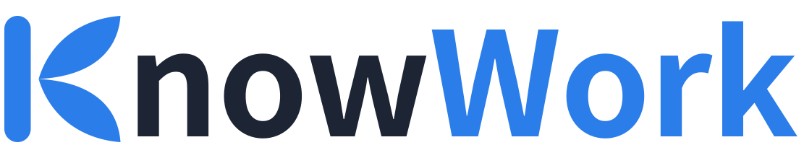
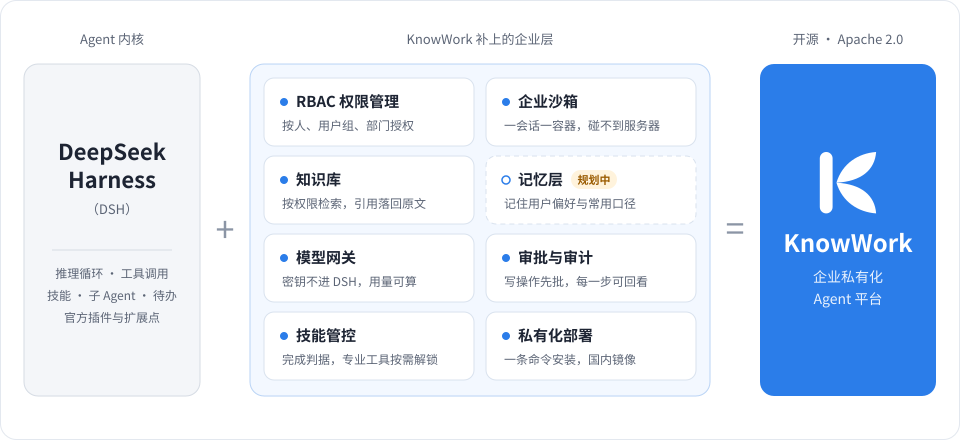
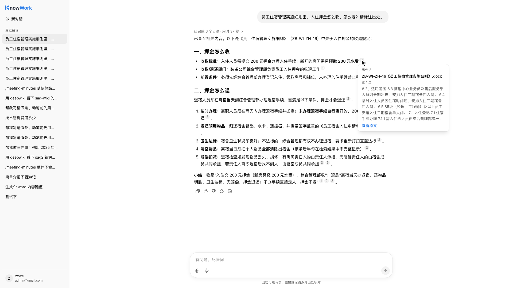
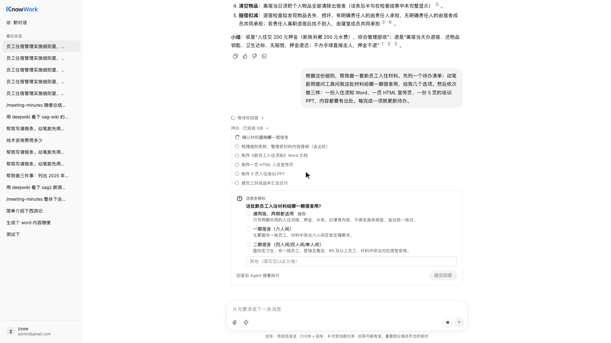
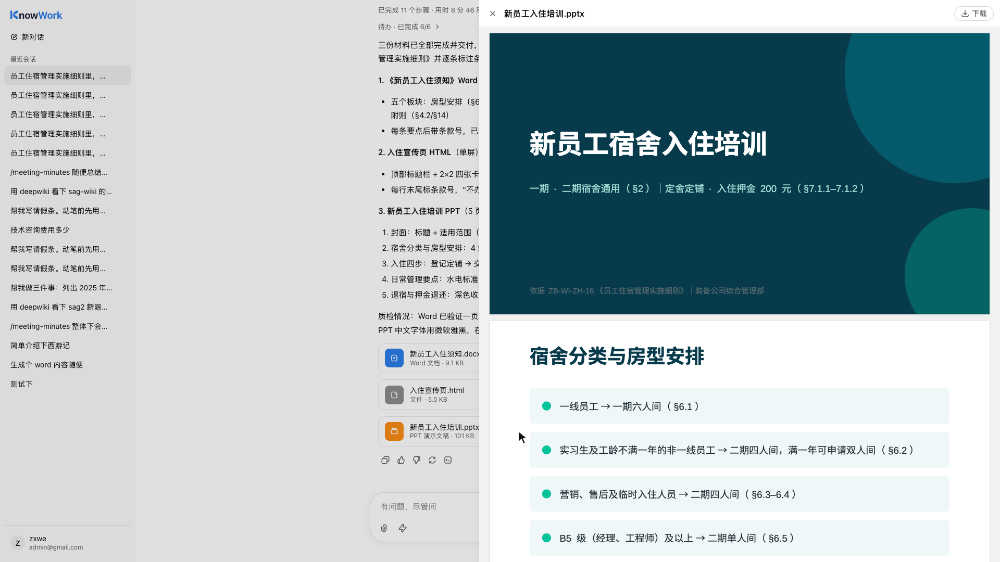
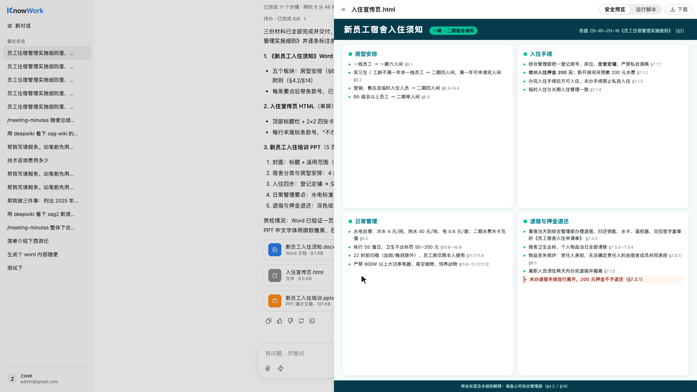
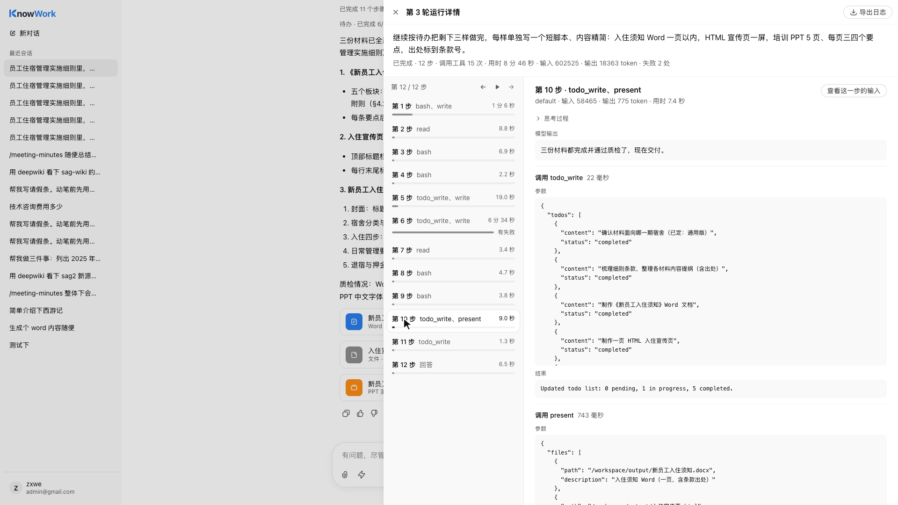
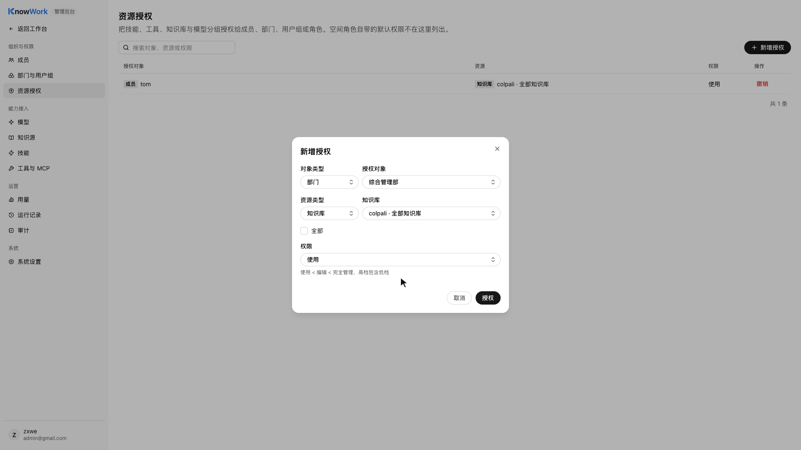

<p align="center">
  
</p>

<h3 align="center">开源的企业私有化 Agent 平台</h3>

<p align="center">
  以 DeepSeek Harness 为内核，补齐企业上线要的账号权限、会话沙箱、审批、审计与用量。<br>
  你写技能、接工具、接知识库，其余的交给 KnowWork。
</p>

<p align="center">
  <a href="https://github.com/knowflow-ai/KnowWork/releases"></a>
  <a href="LICENSE"></a>
  <a href="https://www.npmjs.com/package/@deepseek-ai/dsh"></a>
</p>

<p align="center">
  简体中文 | <a href="README_en.md">English</a>
</p>

---

> **DeepSeek Harness 让 Agent 会干活，KnowWork 让你只管业务：企业私有化要的那一层，它已经做好了。**

<p align="center">
  
</p>

合同审查、制度问答、报表整理、工单处理，每个行业都会有一批贴着自己业务的 Agent。它们要私有化部署进企业，绕不开同一层东西，
以前每个团队都得从头搭一遍：

| 企业要的 | KnowWork 怎么做 |
|---|---|
| 数据和密钥不出机房 | 整套部署在企业自己的服务器上；模型和工具的凭证只在业务服务里，DSH 拿不到 |
| 谁能用什么，跟着组织架构走 | 模型、知识库、工具、技能按人、用户组、部门授权，沿部门树继承 |
| Agent 碰不到服务器 | 一个会话一个 Docker 容器，模型发起的命令和文件读写都在里面 |
| 写操作有人批，每一步能回看 | 写入类和高风险的工具调用先由发起人批准；每一轮逐步回看，人和 Agent 的操作分开审计 |
| 用量算得清 | 按人、按模型统计 token 与费用 |

**Apache 2.0，没有附加条款。** 可以商用，可以改名、换 Logo、贴牌交付给客户；产品名和 Logo 在系统设置里就能换。

## 演示

https://github.com/user-attachments/assets/e4ac1c88-32c2-4976-8381-e954add99ef6

<p align="center">
  <sub>两分多钟走一遍：知识库问答带出处、待办与提问、生成 Word / HTML / PPT 并在线预览、逐步回看、按部门授权与审计。1080p 原片在 <a href="https://github.com/knowflow-ai/KnowWork/releases/download/v0.0.1/knowwork-demo.mp4">Release</a> 下载</sub>
</p>

| 回答带出处，点开就是原文 | 先列待办，动笔前问清楚 |
|:-:|:-:|
|  |  |
| **交付的 PPT 在线预览** | **交付的 HTML 在线预览** |
|  |  |
| **每一轮都能逐步回看** | **知识库按部门授权** |
|  |  |

## 特点

- **写技能就是写 Markdown。** `SKILL.md` 加参考资料打成 ZIP 上传，有草稿和发布版本，可以只授权给某个部门；
  输入 `/技能名` 显式调用，或让模型按需加载。Word、Excel、PPT 三个技能随产品提供。
- **技能能管住模型。** 技能可以声明「必须调用成功的工具」，没做到，模型交不出最终回答；技能认领的专业工具，
  加载技能之前模型看不到。合同审查这类不能靠模型自觉的场景，约束是硬的。
- **引用编不出来。** 回答里的引用编号只能指向这一轮工具实际返回过的证据，点开就是原文。
- **Agent 碰不到服务器。** DSH 官方的本机 shell、文件系统、子进程都换成了落到会话沙箱的实现。附件和知识库里的
  提示词注入，碰不到服务器上的数据库、密钥和别人的数据。
- **DSH 里不放密钥。** 模型调用、工具执行、技能下载都由运行时宿主带短期令牌回调业务服务，凭证从不进 DSH。
- **跟着 DSH 升级，不 fork。** 只用 DSH 官方扩展点：配置档、插件、技能提供方、工具收窄。想看 DSH 怎么做生产级的
  二次开发，这里是一份完整的参考。
- **国内装得上。** 一条命令安装，镜像全在阿里云容器镜像服务；模型接任意 OpenAI 兼容接口，DeepSeek、通义千问、
  自建的 vLLM 都行。

## 快速开始

### 部署到服务器

需要一台 Linux（x86_64）服务器，装好 Docker 24 以上与 Compose v2.24 以上。镜像里会话沙箱最大，约 2.2 GB，磁盘要留足。

```sh
git clone https://github.com/knowflow-ai/KnowWork.git
cd KnowWork
deploy/install.sh
```

脚本会生成 `deploy/.env`、从阿里云容器镜像服务拉镜像、启动服务并等到就绪，最后打印访问地址。云服务器的公网 IP
不在网卡上，用 `deploy/install.sh --url http://公网IP:8080` 指定，并在安全组里放行 8080 端口。浏览器打开后按下面三步走。

1. 按初始化向导创建管理员；
2. 到「管理 → 模型」添加模型厂商和模型，模型别名填 `default`；
3. 回到工作台，开始第一个任务。

> 会话沙箱默认打开，需要把本机的 `docker.sock` 挂给业务服务，这等于给了它宿主机 root 权限，只适合私有化单机部署。
> 不需要执行命令和生成文件时，用 `deploy/install.sh --no-sandbox` 关掉。

部署选项、HTTPS、升级见 [guide/deploy.md](guide/deploy.md)，配置项见 [guide/configuration.md](guide/configuration.md)。
别的系统要调 KnowWork（API Key、对外知识接口、MCP），见 [guide/api.md](guide/api.md)；部署好以后接口文档在 `/api/docs`。

### 本机开发

需要 Python 3.12 与 [uv](https://docs.astral.sh/uv/)、Node.js 22.19 以上、Docker。不用装 PostgreSQL，开发用嵌入式的。

```sh
cd runtime-host && npm install && cd ..
cd web && npm install && cd ..
docker build -f deploy/docker/sandbox.Dockerfile -t knowwork-sandbox:dev .   # 会话沙箱镜像，第一次要构建
cd server && uv sync && uv run python ../scripts/dev_stack.py
```

一条命令拉起嵌入式 PostgreSQL、运行时宿主、业务服务和前端，打开 http://127.0.0.1:5173 。检查命令与代码约定见
[guide/development.md](guide/development.md)。

## 架构

```text
浏览器 ──> 网关（nginx） ──> 业务服务（Python，FastAPI） ──> PostgreSQL / Redis / 对象存储
                                  │  ▲
                     内核合同 kernel.v1  │  短期令牌回调：模型调用、工具执行、技能下载、沙箱
                                  ▼  │
                            运行时宿主（Node，DSH） ──> 会话沙箱（每个会话一个 Docker 容器）
```

- 浏览器只连业务服务。账号、权限、模型密钥、审计都在业务服务里，DSH 里不放密钥，也不做权限判断。
- 运行时宿主用 DSH 官方的配置档与插件扩展点组装 Agent；模型调用、工具执行都由宿主带短期令牌回调业务服务。
- 业务服务只通过带版本号的内核合同调用宿主，DSH 升级时变化收在宿主一侧。

| 目录 | 内容 |
|---|---|
| `server/` | 业务服务：Python 3.12、FastAPI、SQLAlchemy 2（异步）、Alembic |
| `runtime-host/` | 运行时宿主：DSH 配置档、插件组装（`cordis.patch.yml`）与 KnowWork 自己的插件 |
| `web/` | 前端：React 19、TypeScript、Vite、Tailwind 4 |
| `deploy/` | Docker Compose、各镜像的 Dockerfile、nginx 网关、`install.sh` |
| `guide/` | 部署、配置、开发、API 使用说明 |


## 几个设计取舍

**只做网页版，不做桌面版。** 企业私有化部署是多人共用一台服务器，权限、模型、审计都要由管理员集中管；
员工打开浏览器就能用，不用在每台电脑上装客户端。

**持续兼容 DSH。** KnowWork 不 fork DSH，具体做法有三条。

- 所有 `@deepseek-ai/*` 包锁在同一个版本（当前 `0.2.1-rc.2`）；
- 升级前先跑预检和准入测试（建会话、执行、取消、恢复、技能加载、子 Agent、工具桥等），通过才换版本；
- DSH 发新版本后跟进升级，DSH 自带的新能力直接用上。

**命令一律落到沙箱。** 桌面端的 Agent 可以假定「这台机器归用户一个人」，企业服务器不行：上面有数据库连接、密钥和
别人的数据。所以模型发起的命令和文件读写不在宿主本机执行，都经业务服务落到会话自己的容器里。代价是命令要等跑完
才一次拿回输出，需要和宿主实时双向通信的 DSH 能力暂时用不了。

## 功能清单

<details>
<summary>展开全部功能：对话、沙箱、交付、技能、知识与工具、模型、组织与审计、账号、部署</summary>

### 对话与执行

| 能力 | 说明 |
|---|---|
| 执行过程可见 | 流式展示模型的每一步，调了哪个工具、参数和结果都能看到，默认收起，随时展开；回答逐字输出 |
| 快速问答 | 只查知识库（检索，片段不全时读命中处前后）、带出处作答，不走完整的智能体流程；会话中途可以在智能体和快速问答之间切换 |
| 思考开关 | 对话模型可以开关思考，按各服务商自己的参数写法传 |
| @ 点名 | 输入框里 @ 知识库，这一轮只查点到的库；@ 技能等于显式调用它 |
| 插话与取消 | 回车把消息排到当前任务完成后发送，组合键补充给正在跑的任务；随时可以取消 |
| 任务不中断 | 关掉浏览器，任务照样在服务端跑完；运行时宿主重启后会话自动恢复 |
| DSH 原生能力 | 子 Agent、待办清单、后台任务、向用户提问，都在网页里展示和应答 |
| 附件 | 上传的文件放进会话沙箱给模型读；PDF、Office 经 MinerU 解析成 Markdown，MinerU 在管理后台配置，改了不用重启 |
| 引用溯源 | 回答里的引用编号只能指向工具实际返回过的证据，点开看原文 |
| 技能调用 | 输入 `/技能名` 显式调用，或由模型按需加载 |
| 回答语言 | 可指定中文或英文，不指定时按提问判断 |
| 运行详情 | 逐步查看自己这一轮的模型输出、工具调用和失败重试 |

### 会话沙箱

| 能力 | 说明 |
|---|---|
| 一会话一容器 | 模型的命令和文件读写都在这个会话自己的 Docker 容器里，碰不到服务器上的数据库、密钥和别人的数据 |
| 加固 | 去掉全部 Linux 能力、禁止提权；可以断网；可以换用 gVisor 等运行时 |
| Office 工具链 | 内置 LibreOffice、docx-js、pptxgenjs、pandas、matplotlib 等，Word、Excel、PPT 能生成，也能在原文件上修订、批注、重算公式 |
| 自动回收 | 空闲容器自动回收，再用时附件重新放好 |

### 交付文件

| 能力 | 说明 |
|---|---|
| 明确交付 | 只有模型用 DSH 官方的 `present` 交付的文件才进会话，过程中的临时文件不会混进来 |
| 在线预览 | Word、Excel、PDF、Markdown、CSV 等在线预览；Word 直接渲染原件，表格行号与 Excel 一致；PDF 文字可选中、可缩放 |
| 安全下载 | 下载时实时校验权限；导出的表格做了公式注入防护 |

### 技能

| 能力 | 说明 |
|---|---|
| 技能包 | `SKILL.md` 加资料打成 ZIP 上传，可声明需要的环境变量 |
| 草稿与发布 | 发布带版本号；分个人技能和空间技能；可以停用 |
| 内置 Office 技能 | Word、Excel、PPT 三个技能随产品提供 |
| 完成判据 | 技能可以声明必须成功调用的工具，没做到，模型给不出最终回答 |
| 专业工具解锁 | 技能认领的专业工具，在加载技能之前对模型不可见 |
| 运行事实 | 每次运行记下版本、调用方式、每一步的结果、耗时、用量和失败阶段；按版本看成功率，点开看那一轮的每一步 |

### 知识与工具

| 能力 | 说明 |
|---|---|
| KnowFlow 知识库 | 按知识库授权，只检索提问人有权使用的库，引用落回原文 |
| 对外检索 | 别的系统经 REST 接口或 MCP 检索知识库；API Key 要带 `knowledge:read` 范围，按 Key 所属用户的授权收窄 |
| MCP | 管理员接入 MCP 服务，按人、用户组、部门授权 |
| 审批 | 写入类和高风险的工具调用前由发起人批准，可以选「本会话内同类操作不再询问」 |
| 动作回执 | 每次工具调用按动作唯一记录，重试不会重复执行写操作 |
| 凭证不可见 | 工具和模型的凭证只在业务服务里，模型和运行时宿主都拿不到 |

### 模型

| 能力 | 说明 |
|---|---|
| 模型目录 | 接 OpenAI 兼容接口的模型（DeepSeek、通义千问、自建的 vLLM 等），带连通测试 |
| 模型网关 | 运行时宿主带短期令牌经业务服务调用模型，密钥加密存储；单轮调用次数有上限，防止失控 |
| 用量与费用 | 按人、按模型统计 token 与费用 |

### 组织、权限与审计

| 能力 | 说明 |
|---|---|
| 组织 | 成员、邀请、部门树、用户组 |
| 角色与授权 | 空间内三档角色（所有者、管理员、成员）；技能、工具、知识库可以授权给人、用户组、部门，沿部门树继承；登记的模型空间成员都能用 |
| 数据隔离 | PostgreSQL 行级安全按工作空间隔离，应用账号不是表的所有者 |
| 审计 | 人的写操作和 Agent 的工具调用分开记录，可以查询 |
| 运行记录 | 管理员按时间、成员、状态查看全空间的每一轮；查看别人的运行会记进审计 |

### 账号与系统

| 能力 | 说明 |
|---|---|
| 登录 | 账号密码、邀请注册、OIDC 单点登录；登录失败有限流 |
| API Key | 个人 API Key 只存哈希，限定权限范围，可设过期、可吊销 |
| 品牌 | 产品名称和 Logo 可以在系统设置里换成自己的 |

### 部署与运维

| 能力 | 说明 |
|---|---|
| 一条命令安装 | `install.sh` 检查环境、生成配置、拉镜像、启动并等到就绪 |
| 国内可用 | 全部镜像放在阿里云容器镜像服务，包括 PostgreSQL、Redis、RustFS |
| 自动迁移 | 业务服务启动时自动升级数据库，带锁 |
| 密钥自动生成 | 部署主密钥自动生成，其余凭证由它派生，不用手填 |
| 健康检查 | `/ready` 报告数据库和运行时宿主是否正常 |
| 运行面板 | 系统管理员看后台任务（附件解析等）的排队、执行和 worker 心跳 |

</details>

## 现状与路线图

当前版本 v0.0.4，接口和数据结构在 1.0 之前还可能变。已知限制见 [CHANGELOG.md](CHANGELOG.md)。

接下来要做：技能验证台（用例、结构断言、草稿版对比发布版）、场景包、固定工作流的界面、备份与恢复、修改密码与禁用账号。

## 参与开发

欢迎这几类贡献：

- **写技能**：把你所在行业的做法写成技能包，在 issue 里分享；
- **接工具**：接入 MCP 服务时踩到的坑、缺的配置项；
- **沙箱与部署**：别的容器运行时、别的发行版和云厂商上装不上的问题；
- **文档**：`guide/` 目前只有中文，欢迎补英文。

新功能或较大的改动请先开 issue 说清楚要解决什么问题。提交前请读 [CONTRIBUTING.md](CONTRIBUTING.md)，
安全问题请按 [SECURITY.md](SECURITY.md) 私下报告。觉得 KnowWork 有用，点个 Star 能让更多人看到它。

## 相关项目

KnowWork 和下面几个项目同属一个产品家族：KnowFlow 管知识，KnowFlow Analytics 管数据，KnowEval 管评测，KnowWork 管干活。

| 项目 | 是什么 |
|---|---|
| [KnowFlow](https://github.com/knowflow-ai/KnowFlow) | 企业知识库。KnowWork 内置了它的连接器，接上后 Agent 只检索提问人有权使用的库，引用落回原文 |
| [KnowFlow Analytics](https://github.com/knowflow-ai/analytics) | 面向 AI Agent 与数据应用的开源语义层和受治理查询引擎。指标、维度、口径维护成可版本化的语义模型，大模型只写业务名组成的语义 SQL，访问数据库的 SQL 由系统确定性编译 |
| [KnowEval](https://github.com/knowflow-ai/KnowEval) | 中文企业文档 RAG 的端到端开源评测工具。从原始文档出发，测答得准不准、不知道时会不会说不知道、引用能不能和原文对上 |

## 许可证与致谢

KnowWork 以 [Apache License 2.0](LICENSE) 发布。

- [DeepSeek Harness](https://www.npmjs.com/package/@deepseek-ai/dsh)，Agent 内核（MIT）。
- [WeKnora](https://github.com/Tencent/WeKnora)，会话沙箱的 Docker 后端与部署编排、IM 渠道、知识检索与引用、回答方式与输入框的 @ 菜单参照了它的做法（MIT）。
- [@openai/apps-sdk-ui](https://www.npmjs.com/package/@openai/apps-sdk-ui)，界面组件（MIT）。

第三方声明见 [NOTICE](NOTICE)。

## 社区与支持

- **微信公众号** - KnowFlow 企业知识库
- **交流群** - 加微信 `skycode007`，备注「加群」
- **问题反馈** - [GitHub Issues](https://github.com/knowflow-ai/KnowWork/issues)
