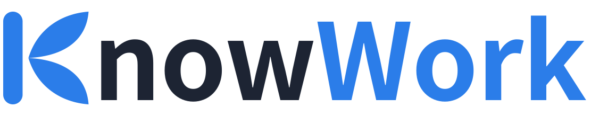
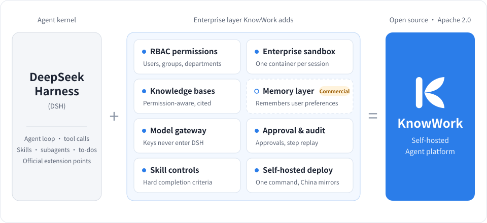
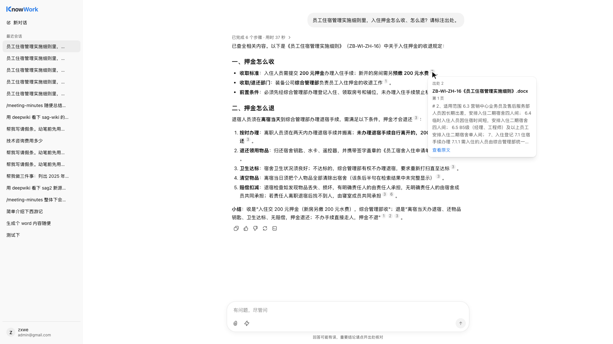
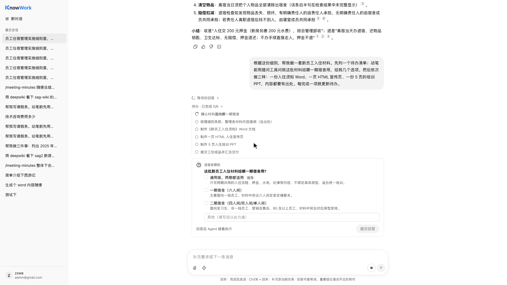
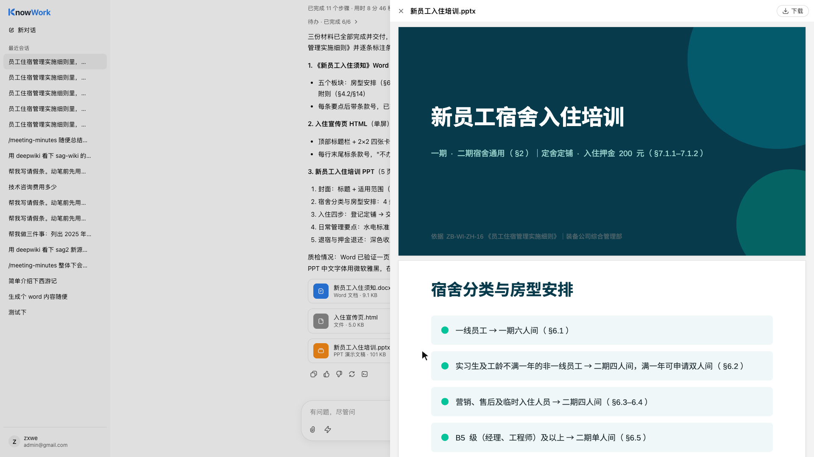
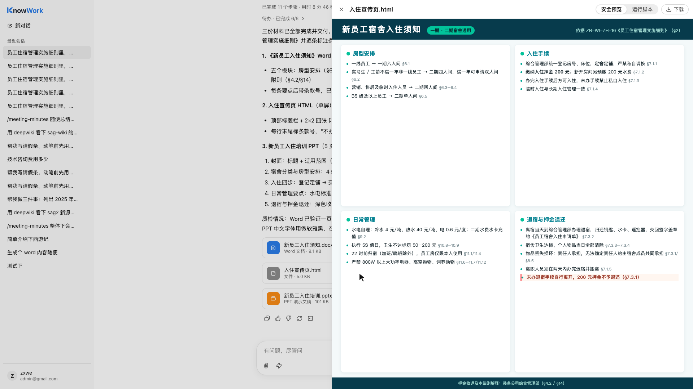
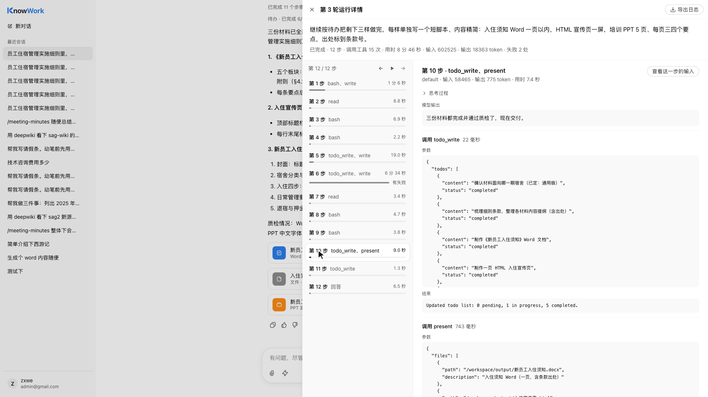
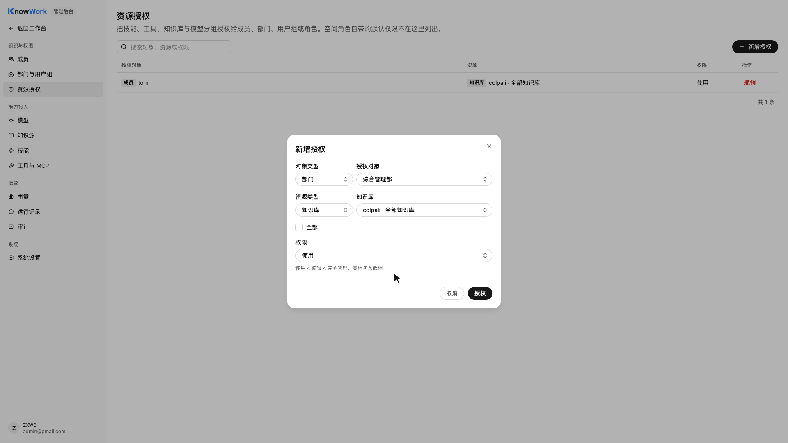

<p align="center">
  
</p>

<h3 align="center">The open-source, self-hosted Agent platform for enterprises</h3>

<p align="center">
  Built on DeepSeek Harness, with the accounts, permissions, sandboxes, approvals, audit and usage tracking an enterprise needs to go live.<br>
  You write skills and connect tools and knowledge bases. KnowWork handles the rest.
</p>

<p align="center">
  <a href="https://github.com/knowflow-ai/KnowWork/releases"></a>
  <a href="LICENSE"></a>
  <a href="https://www.npmjs.com/package/@deepseek-ai/dsh"></a>
</p>

<p align="center">
  English | <a href="README_zh.md">简体中文</a>
</p>

---

> **DeepSeek Harness teaches an agent to work. KnowWork lets you focus on the business: the layer a self-hosted enterprise deployment needs is already built.**

<p align="center">
  
</p>

Contract review, policy Q&A, report preparation, ticket handling: every industry will have its own agents built around
its business. To be deployed inside an enterprise, all of them need the same layer underneath, and until now every team has had
to build it from scratch:

| What the enterprise needs | What KnowWork does |
|---|---|
| Data and keys stay in the data center | The whole stack runs on the company's own servers; model and tool credentials live only in the business service, out of DSH's reach |
| Access follows the org chart | Models, knowledge bases, tools and skills are granted to users, groups and departments, inherited down the department tree |
| The agent cannot touch the server | One Docker container per session; every command and file operation the model starts happens inside it |
| Writes are approved, every step can be replayed | Write and high-risk tool calls are approved by the person who started the turn; every turn can be replayed step by step; human and agent actions are audited separately |
| Usage is accountable | Tokens and cost per user and per model |

**Apache 2.0, no extra terms.** Use it commercially, rename it, replace the logo, and deliver it to clients under your
own brand; the product name and logo can be changed in system settings.

## Demo

https://github.com/user-attachments/assets/e4ac1c88-32c2-4976-8381-e954add99ef6

<p align="center">
  <sub>A 2-minute walkthrough (Chinese UI and voice-over): cited knowledge-base answers, to-dos and questions, generating and previewing Word / HTML / PPT, step-by-step replay, department grants and audit. The 1080p original is on the <a href="https://github.com/knowflow-ai/KnowWork/releases/download/v0.0.1/knowwork-demo.mp4">Release</a> page</sub>
</p>

| Answers cite their sources; click to see the original | A to-do list first, and questions before writing |
|:-:|:-:|
|  |  |
| **Delivered PPT, previewed online** | **Delivered HTML, previewed online** |
|  |  |
| **Replay every turn step by step** | **Grant knowledge bases by department** |
|  |  |

## Highlights

- **A skill is a Markdown file.** Zip a `SKILL.md` with its reference material and upload it. Skills have drafts and
  published versions and can be granted to a single department; type `/skill-name` to call one, or let the model load
  it when needed. Word, Excel and PowerPoint skills ship with the product.
- **Skills keep the model in line.** A skill can declare tools that must succeed; until they do, the model cannot give
  a final answer. Specialist tools claimed by a skill stay hidden from the model until the skill is loaded. For work
  like contract review, where you cannot rely on the model's good intentions, the constraint is hard.
- **Citations cannot be made up.** Citation numbers in an answer can only point to evidence a tool actually returned in
  that turn; click one to see the source.
- **The agent cannot touch the server.** DSH's built-in local shell, file system and subprocess plugins are replaced by
  implementations that run inside the session sandbox. Prompt injection hidden in attachments or knowledge bases cannot
  reach the server's database, keys or other people's data.
- **No keys inside DSH.** Model calls, tool execution and skill downloads go from the runtime host back to the business
  service with short-lived tokens; credentials never enter DSH.
- **Upgrades with DSH, never forks it.** Only DSH's official extension points are used: profiles, plugins, skill
  providers and tool restriction. If you want to see what a production-grade DSH extension looks like, this is a
  complete example.
- **Installs in mainland China.** One command installs everything, and every image is hosted on Alibaba Cloud Container
  Registry. Any model with an OpenAI-compatible API works: DeepSeek, Qwen, self-hosted vLLM and others.

## Open source and commercial editions

The open source edition is this repository, under Apache 2.0. The commercial edition adds, as extensions on top of it, a
built-in knowledge base, multiple workspaces, an enterprise layer for skills and MCP, directory sync, long-term memory and
analytics, each enabled by the license file. Commercial images are built on the open source images, so everything in the
open source edition is in the commercial edition too.

> **Illustrated guides to the two main commercial modules (in Chinese):** [Built-in knowledge base](https://www.knowflowchat.cn/work/docs/category/%E7%9F%A5%E8%AF%86%E5%BA%93) · [Analytics](https://www.knowflowchat.cn/work/docs/category/%E6%99%BA%E8%83%BD%E9%97%AE%E6%95%B0)

| Area | Capability | Open source | Commercial |
|---|---|:-:|:-:|
| Chat and delivery | Agent chat, quick answers, live view of every step, interject and cancel | ✓ | ✓ |
| | Attachment parsing (MinerU), citations back to the source, mermaid diagrams in answers | ✓ | ✓ |
| | Word, Excel, PPT and HTML produced in the session sandbox, with in-browser preview | ✓ | ✓ |
| Knowledge | KnowFlow knowledge bases: per-base grants, citations back to the source | ✓ | ✓ |
| | Other systems search knowledge bases over REST or MCP | ✓ | ✓ |
| | Built-in knowledge base: upload, parsing, chunking, retrieval, metadata and tags, version governance (see the table below) | — | ✓ |
| | Multi-hop retrieval and knowledge graph (SAG), structure enhancement (MinerU-Popo), visual retrieval (ColPali); see the table below | — | ✓ optional services |
| | Knowledge gaps: unanswered questions listed per knowledge base for its maintainers | — | ✓ |
| IM channels | WeCom smart bots, Feishu bots and DingTalk Stream mode; the server connects out to each platform, so no public callback URL or inbound port is needed | ✓ | ✓ |
| | Each bot has its own answer mode and set of knowledge bases and answers under its own account; in groups it replies only when @-mentioned | ✓ | ✓ |
| | Answers stream as they are written (WeCom streaming messages, Feishu and DingTalk streaming cards); cited images from knowledge bases are sent with the answer and open on phones even in intranet deployments | ✓ | ✓ |
| | One conversation per person and per group with context kept, "新会话" starts over, and the admin page shows who has asked | ✓ | ✓ |
| Skills | ZIP skill packages, drafts and releases, grants to people, groups and departments | ✓ | ✓ |
| | Built-in Word, Excel and PPT skills | ✓ | ✓ |
| | Personal skills, submitted to the workspace for admin review | ✓ | ✓ |
| | Skill environment variables stored encrypted and masked in command output | ✓ | ✓ |
| | Completion criteria, specialist tool unlocking, run facts per version | ✓ | ✓ |
| | Enterprise skills: published by the system admin to workspaces, which can disable or narrow them | — | ✓ |
| MCP tools | Four auth modes: none, shared credentials, personal access token, OAuth | ✓ | ✓ |
| | Members connect their own accounts and calls run with their own permissions | ✓ | ✓ |
| | Each tool allowed, confirm-first or disabled; write calls approved by the requester | ✓ | ✓ |
| | Enterprise MCP: register once for many workspaces, or promote a workspace MCP server | — | ✓ |
| Memory | Personal long-term memory: explicit or extracted, pending confirmation, daily consolidation, recalled per question | — | ✓ |
| | Workspace instructions and enterprise instructions | — | ✓ |
| Organisation and access | Members, invitations, department tree, groups, three workspace roles | ✓ | ✓ |
| | Resource grants for knowledge bases, skills and tools to people, groups, departments and roles, in bulk | ✓ | ✓ |
| | Workspaces | One default workspace | Multiple, with read-only knowledge base sharing across them |
| Sign-in and directory | Password, invitations, OIDC and generic OAuth2 (configured in the admin console), personal API keys | ✓ | ✓ |
| | Directory sync: LDAP / AD, WeCom, adapter API for in-house systems | — | ✓ |
| | Domain account sign-in, WeCom QR sign-in and in-app single sign-on | — | ✓ |
| | Membership rules (department members join a workspace automatically), auto-deactivation of leavers, deletion safeguards | — | ✓ |
| Analytics | Query PostgreSQL and MySQL by the metric definitions in a semantic model, explain changes by attribution, and edit, drill into and pin result cards to dashboards (see the table below) | — | ✓ optional module |
| Operations and audit | Q&A dashboard, run records, usage and cost, audit trail | ✓ | ✓ |
| Deployment | One-command Docker Compose install, images on Alibaba Cloud, automatic database upgrades on start | ✓ | ✓ |
| License | | Apache 2.0 | Commercial license |

Enterprise skills and enterprise MCP only make sense with several workspaces, so they ship in the commercial edition; the open
source edition has a single default workspace, and its enterprise layer holds only the built-in Word, Excel and PPT skills.
Analytics is enabled together with the built-in knowledge base.

### Built-in knowledge base (commercial edition)

**The built-in knowledge base is a commercial edition feature, not included in the open source edition**, which connects to KnowFlow knowledge bases instead. Step-by-step guides to creating knowledge bases, managing documents, retrieval and retrieval testing, metadata and tags, multi-hop and visual retrieval, knowledge gaps, and sharing, export and import: see the **[knowledge base guide](https://www.knowflowchat.cn/work/docs/category/%E7%9F%A5%E8%AF%86%E5%BA%93)** (in Chinese).

| Aspect | Capabilities |
|---|---|
| Management | Folder tree; grants per knowledge base and folder at three levels (use, edit, manage); read-only sharing across workspaces |
| Formats | PDF, Word (.doc / .docx), PPT (.pptx), Excel (.xlsx), CSV, Markdown and plain text, up to 200 MB per file |
| Parsing | MinerU layout and table parsing, OCR for scans, Chinese descriptions for images; parsed chunks can be reviewed and corrected by hand |
| Chunking | Four modes: automatic, by section, by page, parent-child |
| Retrieval | Hybrid semantic and keyword search, reranking, synonyms; filters by folder, tag and metadata; exact matching for codes and model numbers |
| Metadata and tags | Every knowledge base has a built-in Tags field, plus custom text, number and date fields; text fields can have allowed values and hold several values; values filled per document or in bulk, or extracted automatically by the model, which picks only from allowed values and never overwrites what people entered; the agent narrows searches by fields and tags, compares numbers and dates by range, and accepts dates written as a year or month; the conditions used are shown above the answer and can be removed to answer again |
| Reading | The agent opens the outline, reads whole sections and fetches originals and page images; citations point to the paragraph, with in-browser preview and highlighting for Word, PDF, PPT and Excel; cited charts are placed back in the answer |
| Governance | Old and new versions of the same file recognised, answers follow the newest; knowledge base descriptions generated automatically |
| Ingestion | Manual upload; scheduled sync from S3-compatible storage, SMB shares and WebDAV; knowledge base export and import; re-embedding |
| Troubleshooting | Retrieval test page showing which chunks a question hits and how they rank; recall and reranking of every search in run records; knowledge gaps |
| Multi-hop retrieval and knowledge graph (SAG, optional service) | Events and entities extracted from documents at ingestion form a knowledge graph; when a question needs several documents tied together (who relates to whom, causes and consequences, cross-document comparison), multi-hop recall runs alongside semantic and keyword search and the results are merged and reranked; a graph page shows how events and entities connect, with each event's summary, entities and source documents and sections; index status shows how many documents are built, building or failed, with a rebuild action |
| Structure enhancement (MinerU-Popo, optional service) | A second pass on PDFs after parsing and before chunking: headings re-levelled from 1 to 6 and false headings turned back into body text; paragraphs split by figures, columns or page breaks joined again; tables spanning pages merged with repeated headers removed; figures and tables attached to their sections. The results are written back into the parsed document, so chunking, citation highlighting and the document outline all use them; when it does not apply, the MinerU result is used as is and the processing timeline says why |
| Visual retrieval (ColPali, optional service) | Each PDF and PPT page stored as page-image vectors to find charts, layouts and scanned content by how the page looks; matching pages expand into their chunks and merge with text recall before reranking |
| Enhanced retrieval switches | Each knowledge base sets multi-hop and visual retrieval to off, on demand (default, decided by the agent per question) or always on; timeouts and errors fall back to normal retrieval, with the reason recorded in the retrieval trace and shown on the retrieval test page |

The built-in knowledge base stores vectors in Milvus, which the commercial deployment sets up.

### Analytics (commercial edition)

**Analytics is a commercial edition feature, not included in the open source edition**, and is enabled together with the built-in knowledge base. Step-by-step guides to connecting data sources, curating the semantic model, asking questions and reading results, trusted queries and evaluation, and configuration: see the **[analytics guide](https://www.knowflowchat.cn/work/docs/category/%E6%99%BA%E8%83%BD%E9%97%AE%E6%95%B0)** (in Chinese).

| Aspect | Capabilities |
|---|---|
| Data sources | PostgreSQL and MySQL; the connection test checks whether the account is read-only (PostgreSQL); an allowlist of the tables and views analytics may use; scans of row counts, null rates and common values per column, plus the database's query history (pg_stat_statements on PostgreSQL, statement digests on MySQL) |
| Automatic modelling | A first semantic model drafted right after the scan: datasets, fields, primary keys and sample values, with joins inferred from foreign keys, column names and the join conditions in the query history, kept only once checked against the data; AI drafting adds Chinese names and descriptions, suggests common metrics from the most frequent aggregations in the history and finds missed joins; an existing set of "question, SQL" pairs can be imported as a CSV of trusted queries before AI drafting |
| Metrics and definitions | Name, aliases, description and topics; sum, count, distinct count, average, max, min or a hand-written expression; built-in filters, time field and default time window; derived metrics computed from other metrics (refunds divided by orders, for example), even across tables; window metrics: same period last year, same period last month, running totals and the last N periods; named filters and analytics instructions |
| Relationships | Equality joins on foreign keys; interval joins and ASOF joins (the latest row not after the time) for slowly changing tables and validity periods; when the metrics in one query live in several tables, each table is aggregated first and the results merged by group, so numbers are never inflated by fan-out |
| Releases and versions | Diff before publishing; every publish is a new version that can be rolled back; the metrics page shows the semantic model as a tree with details and files; zip export and import, plus single-file Ossie export and import to exchange models with other tools that read Ossie; ask the assistant in chat to read the model and edit names and descriptions |
| Asking | Pick the "Analytics" answer mode, @-mention a data source or start from the data source page; ask in business terms, with phrases such as "East China" mapped to the stored values, and with value search switched on for a text field, similar stored values are looked up before each question; follow-up questions keep the context; when a question cannot be answered, the reason is given with questions that can be; with several data sources and none named, the assistant asks which one to use |
| Querying | Metric queries and detail rows compiled to SQL by the server from the semantic model; when metrics do not cover a question, governed SQL limited to a single SELECT over dataset names; identical queries reuse the previous result for a while (10 minutes by default, adjustable per data source), and the definition states when the data was fetched |
| Attribution | "Why did it go up or down": for one metric and two periods, the change is broken down by one to three grouping fields (and their pairs), with the base, current, change, share and growth rate of each group, computed on the server without an LLM |
| Result cards | A written conclusion plus a result card with line, bar or pie charts that switch to a table; the definition lists the metric, time range, rules applied, model version and the SQL actually run; edit the conditions on the card (time, filters, named filters, or the SQL itself for SQL queries) and re-run in place; click a value on a chart or table to drill down, filtering by that value and swapping that column for a chosen field, with a step back; download the full result as CSV; suggested follow-up questions to ask with one click |
| Dashboards | Pin result cards to dashboards; the query is saved, not the result, so opening a dashboard re-runs each card on the current model version under the viewer's row and column rules, and relative times such as "last month" can follow the calendar; a two-column grid with half and full widths and drag to reorder; conditions can be edited and values drilled into on the dashboard too; the creator and workspace admins can share it for viewing or editing |
| Trusted queries and evaluation | Good answers saved as trusted queries, recalled by phrasing for the assistant and usable as example questions; after model changes, evaluations re-ask each trusted query and compare results row by row without an LLM judge, reporting passes and regressions |
| Data permissions | Resource grants decide who may use a data source; per-table row rules (by the values of one column) and column rules for people, departments, groups and roles, enforced on the server so neither assistant-written SQL nor dashboard cards can bypass them |
| Execution safety | Queries run in read-only transactions; row estimates from the query plan are checked against a cap before running; statement timeouts; a cap on returned rows |

For trials and pricing of the commercial edition, see the [website](https://www.knowflowchat.cn/contact) or add WeChat `skycode007`.

## Quick start

### Deploy to a server

You need a Linux x86_64 server with Docker 24+ and Compose v2.24+. The session sandbox is the largest image at about
2.2 GB, so leave enough disk space.

```sh
git clone https://github.com/knowflow-ai/KnowWork.git
cd KnowWork
deploy/install.sh
```

The script writes `deploy/.env`, pulls images from Alibaba Cloud Container Registry, starts the services, waits until
they are ready and prints the address to open. On a cloud server the public IP is usually not on the network interface:
pass it with `deploy/install.sh --url http://<public-ip>:8080` and open port 8080 in the security group. Then:

1. follow the setup wizard to create the administrator;
2. go to Admin → Models, add a provider and a model, and set the model alias to `default`;
3. go back to the workspace and start your first task.

> The session sandbox is on by default. It mounts the host's `docker.sock` into the business service, which amounts to
> root on the host, so it is meant for single-server self-hosted deployments only. If you do not need command
> execution or file generation, turn it off with `deploy/install.sh --no-sandbox`.

The documentation under `guide/` is in Chinese: deployment options, HTTPS and upgrades in
[guide/deploy.md](guide/deploy.md), configuration in [guide/configuration.md](guide/configuration.md).

### Local development

You need Python 3.12 with [uv](https://docs.astral.sh/uv/), Node.js 24.9+ and Docker. No PostgreSQL install is needed;
development uses an embedded one.

```sh
cd runtime-host && npm install && cd ..
cd web && npm install && cd ..
docker build -f deploy/docker/sandbox.Dockerfile -t knowwork-sandbox:dev .   # session sandbox image, first time only
cd server && uv sync && uv run python ../scripts/dev_stack.py
```

One command starts the embedded PostgreSQL, the runtime host, the business service and the frontend; open
http://127.0.0.1:5173. Checks and code conventions are in [guide/development.md](guide/development.md).

## Architecture

```text
Browser ──> Gateway (nginx) ──> Business service (Python, FastAPI) ──> PostgreSQL / Redis / object storage
                                     │  ▲
                    kernel contract  │  │  short-lived token callbacks: model calls, tool execution,
                         kernel.v1   ▼  │  skill downloads, sandbox
                               Runtime host (Node, DSH) ──> Session sandbox (one Docker container per session)
```

- The browser only talks to the business service. Accounts, permissions, model keys and audit live there; DSH holds
  no keys and makes no permission decisions.
- The runtime host assembles agents with DSH's official profiles and plugin extension points; model calls and tool
  execution go back to the business service with short-lived tokens.
- The business service calls the runtime host only through a versioned kernel contract, so DSH upgrades stay on the
  runtime host side.

| Directory | Contents |
|---|---|
| `server/` | Business service: Python 3.12, FastAPI, SQLAlchemy 2 (async), Alembic |
| `runtime-host/` | Runtime host: DSH profile, plugin assembly (`cordis.patch.yml`) and KnowWork's own plugins |
| `web/` | Frontend: React 19, TypeScript, Vite, Tailwind 4 |
| `deploy/` | Docker Compose, Dockerfiles for each image, the nginx gateway, `install.sh` |
| `guide/` | Deployment, configuration, development |


## Design choices

**Web only, no desktop app.** A self-hosted enterprise deployment is one server shared by many people, and
permissions, models and audit are managed centrally by administrators. Employees open a browser and start working;
nothing has to be installed on each computer.

**Continuous compatibility with DSH.** KnowWork does not fork DSH. In practice:

- all `@deepseek-ai/*` packages are pinned to the same version (currently `0.2.2-rc.1`);
- before an upgrade, a preflight check and admission tests run (create a session, run, cancel, resume, load skills,
  subagents, the tool bridge and more), and the version is switched only when they pass;
- new DSH releases are followed, and capabilities that ship with DSH are picked up directly.

**Every command runs in the sandbox.** A desktop agent can assume the machine belongs to one user. An enterprise server
cannot: it holds database connections, keys and other people's data. So commands and file operations started by the
model never run on the runtime host itself; they go through the business service into the session's own container. The
cost is that a command's output comes back only once it has finished, and DSH features that need live two-way
communication with the host are not available for now.

## Features

<details>
<summary>Show all features: conversations, sandbox, delivered files, skills, knowledge and tools, models, organization and audit, accounts, deployment</summary>

### Conversations and execution

| Feature | Description |
|---|---|
| Visible execution | Every step the model takes is streamed: which tool it called, with what arguments and what came back. Collapsed by default, expandable at any time; answers stream token by token |
| Quick answer | Answers only from the knowledge bases (searches them, and reads around a hit when the excerpt is incomplete), with citations, without the full agent loop; switch between agent and quick answer mid-conversation |
| Thinking switch | Turn the chat model's thinking on or off, sent the way each provider expects |
| @ mentions | @ a knowledge base in the input box to search only that base this turn; @ a skill to invoke it explicitly |
| Follow-ups and cancel | Enter queues a message until the current task finishes; a key combination adds it to the running task. Cancel at any time |
| Tasks keep running | Close the browser and the task still finishes on the server; sessions resume automatically after the runtime host restarts |
| Native DSH features | Subagents, to-do lists, background jobs and questions to the user are shown and answered in the web UI |
| Attachments | Uploaded files are placed in the session sandbox for the model to read; PDF and Office files are parsed to Markdown by MinerU, configured in the admin console without a restart |
| Traceable citations | Citation numbers in an answer can only point to evidence a tool actually returned; click to see the source |
| Skill invocation | Type `/skill-name` to invoke a skill explicitly, or let the model load it when needed |
| Answer language | Choose Chinese or English; otherwise it follows the question |
| Run details | Step through your own turn: model output, tool calls, failures and retries |

### Session sandbox

| Feature | Description |
|---|---|
| One container per session | The model's commands and file operations stay inside the session's own Docker container, away from the server's database, keys and other people's data |
| Hardening | All Linux capabilities dropped, privilege escalation blocked; network access can be turned off; runtimes such as gVisor can be used |
| Office toolchain | LibreOffice, docx-js, pptxgenjs, pandas, matplotlib and more are built in. Word, Excel and PowerPoint files can be created, and existing files edited with tracked changes, comments and formula recalculation |
| Automatic cleanup | Idle containers are reclaimed; attachments are put back when the session is used again |

### Delivered files

| Feature | Description |
|---|---|
| Explicit delivery | Only files the model delivers with DSH's official `present` tool show up in the conversation; temporary files do not |
| Online preview | Word, Excel, PDF, Markdown, CSV and more can be previewed; Word files render as the original, sheet row numbers match Excel; PDF text is selectable and zoomable |
| Safe download | Permissions are checked on every download; exported spreadsheets are protected against formula injection |

### Skills

| Feature | Description |
|---|---|
| Skill packages | Upload a ZIP with `SKILL.md` and its resources; required environment variables can be declared |
| Draft and publish | Published versions are numbered; personal and workspace skills; skills can be disabled |
| Built-in Office skills | Word, Excel and PowerPoint skills ship with the product |
| Completion criteria | A skill can declare tools that must succeed; until they do, the model cannot give a final answer |
| Tool unlocking | Specialist tools claimed by a skill stay hidden from the model until the skill is loaded |
| Run records | Every run records the version, how it was invoked, each step's result, duration, usage and failure stage; success rate per version, with a step-by-step view of each turn |

### Knowledge and tools

| Feature | Description |
|---|---|
| KnowFlow knowledge bases | Authorized per knowledge base; only bases the asker may use are searched, and citations lead back to the source |
| External search | Other systems search the knowledge bases over REST or MCP; the API key needs the `knowledge:read` scope and is narrowed to its owner's grants |
| MCP | Administrators connect MCP servers and grant them to users, groups and departments |
| Approvals | Write and high-risk tool calls are approved by the person who started the turn, with the option to allow the same kind of action for the rest of the session |
| Action receipts | Each tool call is recorded once per action, so retries never repeat a write |
| Hidden credentials | Tool and model credentials stay in the business service; neither the model nor the runtime host can see them |

### Models

| Feature | Description |
|---|---|
| Model catalog | Any model with an OpenAI-compatible API (DeepSeek, Qwen, self-hosted vLLM and others), with a connectivity test |
| Groups and grants | Models are granted in groups to users, user groups and departments |
| Model gateway | The runtime host calls models through the business service with short-lived tokens; keys are stored encrypted; calls per turn are capped to stop runaway loops |
| Usage and cost | Tokens and cost per user and per model |

### Organization, permissions and audit

| Feature | Description |
|---|---|
| Organization | Members, invitations, a department tree, user groups |
| Roles and grants | Three roles per workspace (owner, admin, member); skills, tools and knowledge bases can be granted to users, groups and departments, inherited down the department tree; registered models are available to every workspace member |
| Data isolation | PostgreSQL row-level security per workspace; the application account does not own the tables |
| Audit | Human write operations and agent tool calls are recorded separately and can be searched |
| Run history | Administrators browse every turn in the workspace by time, member and status; viewing someone else's run is itself audited |

### Accounts and system

| Feature | Description |
|---|---|
| Sign-in | Password, invitation sign-up, OIDC single sign-on; failed sign-ins are rate limited |
| API keys | Personal API keys are stored only as hashes, limited in scope, with expiry and revocation |
| Branding | The product name and logo can be replaced in system settings |

### Deployment and operations

| Feature | Description |
|---|---|
| One-command install | `install.sh` checks the environment, writes the configuration, pulls images, starts everything and waits until it is ready |
| Works in mainland China | All images, including PostgreSQL, Redis and RustFS, are hosted on Alibaba Cloud Container Registry |
| Automatic migrations | The database is upgraded when the business service starts, under a lock |
| Generated secrets | A deployment master key is generated automatically and all other credentials are derived from it |
| Health check | `/ready` reports whether the database and the runtime host are healthy |
| Jobs panel | System administrators see background jobs (attachment parsing and so on) queued and running, and worker heartbeats |

</details>

## Status and roadmap

The current version is v0.0.9. APIs and data structures may still change before 1.0. Known
limitations are listed in [CHANGELOG.md](CHANGELOG.md).

Next up: a skill test bench (cases, structural assertions, draft versus published comparison), scenario packs, a UI for
fixed workflows, backup and restore, password change and account disabling.

## Contributing

Contributions we would especially welcome:

- **Skills**: turn the way your industry works into a skill package and share it in an issue;
- **Tools**: problems you hit and settings you missed when connecting MCP servers;
- **Sandbox and deployment**: other container runtimes, and distributions or cloud providers where installation fails;
- **Documentation**: `guide/` is Chinese only for now; English translations are welcome.

For new features or larger changes, please open an issue first and describe the problem you want to solve. Read
[CONTRIBUTING.md](CONTRIBUTING.md) before submitting, and report security issues privately as described in
[SECURITY.md](SECURITY.md). If KnowWork is useful to you, a star helps more people find it.

## Related projects

KnowWork belongs to a family of projects: KnowFlow manages knowledge, KnowFlow Analytics manages data, KnowEval
measures quality, and KnowWork gets the work done.

| Project | What it is |
|---|---|
| [KnowFlow](https://github.com/knowflow-ai/KnowFlow) | An enterprise knowledge base. KnowWork ships with a connector for it: once connected, the agent only searches the bases the asker may use, and citations lead back to the source |
| [KnowFlow Analytics](https://github.com/knowflow-ai/analytics) | An open-source semantic layer and governed query engine for AI agents and data apps. Metrics, dimensions and aggregation rules live in a versioned semantic model; the LLM writes semantic SQL in business terms, and the SQL that reaches the database is compiled deterministically |
| [KnowEval](https://github.com/knowflow-ai/KnowEval) | An open-source, end-to-end evaluation tool for RAG over Chinese enterprise documents. Starting from raw documents, it measures whether answers are right, whether the system admits when it does not know, and whether citations match the source |

## License and acknowledgements

KnowWork is released under the [Apache License 2.0](LICENSE).

- [DeepSeek Harness](https://www.npmjs.com/package/@deepseek-ai/dsh), the agent kernel (MIT).
- [WeKnora](https://github.com/Tencent/WeKnora); the Docker backend of the session sandbox and the deployment layout,
  the IM channels, knowledge search and citations, answer modes and the @ menu in the composer follow its approach (MIT).
- [@openai/apps-sdk-ui](https://www.npmjs.com/package/@openai/apps-sdk-ui), UI components (MIT).

Third-party notices are in [NOTICE](NOTICE).

## Community and support

- **WeChat Official Account** - KnowFlow 企业知识库
- **Chat group** - add WeChat `skycode007` with the note "加群" (join group)
- **Issues and questions** - [GitHub Issues](https://github.com/knowflow-ai/KnowWork/issues)
