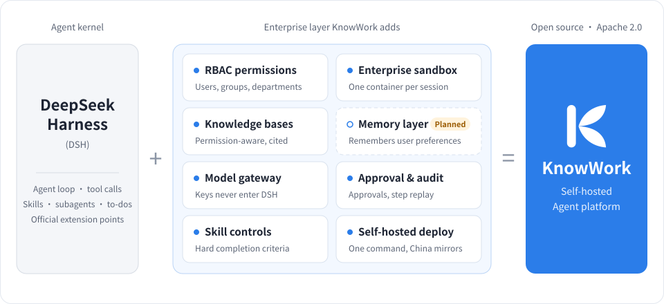

<p align="center">
  
</p>

<h3 align="center">The open-source, self-hosted Agent platform for enterprises</h3>

<p align="center">
  Built on DeepSeek Harness, with the accounts, permissions, sandboxes, approvals, audit and usage tracking an enterprise needs to go live.<br>
  You write skills and connect tools and knowledge bases. KnowWork handles the rest.
</p>

<p align="center">
  <a href="https://github.com/knowflow-ai/KnowWork/releases"></a>
  <a href="LICENSE"></a>
  <a href="https://www.npmjs.com/package/@deepseek-ai/dsh"></a>
</p>

<p align="center">
  <a href="README.md">简体中文</a> | English
</p>

---

> **DeepSeek Harness teaches an agent to work. KnowWork lets you focus on the business: the layer a self-hosted enterprise deployment needs is already built.**

<p align="center">
  
</p>

Contract review, policy Q&A, report preparation, ticket handling: every industry will have its own agents built around
its business. To be deployed inside an enterprise, all of them need the same layer underneath, and until now every team has had
to build it from scratch:

| What the enterprise needs | What KnowWork does |
|---|---|
| Data and keys stay in the data center | The whole stack runs on the company's own servers; model and tool credentials live only in the business service, out of DSH's reach |
| Access follows the org chart | Models, knowledge bases, tools and skills are granted to users, groups and departments, inherited down the department tree |
| The agent cannot touch the server | One Docker container per session; every command and file operation the model starts happens inside it |
| Writes are approved, every step can be replayed | Write and high-risk tool calls are approved by the person who started the turn; every turn can be replayed step by step; human and agent actions are audited separately |
| Usage is accountable | Tokens and cost per user and per model |

**Apache 2.0, no extra terms.** Use it commercially, rename it, replace the logo, and deliver it to clients under your
own brand; the product name and logo can be changed in system settings.

## Demo

https://github.com/user-attachments/assets/e4ac1c88-32c2-4976-8381-e954add99ef6

<p align="center">
  <sub>A 2-minute walkthrough (Chinese UI and voice-over): cited knowledge-base answers, to-dos and questions, generating and previewing Word / HTML / PPT, step-by-step replay, department grants and audit. The 1080p original is on the <a href="https://github.com/knowflow-ai/KnowWork/releases/download/v0.0.1/knowwork-demo.mp4">Release</a> page</sub>
</p>

| Answers cite their sources; click to see the original | A to-do list first, and questions before writing |
|:-:|:-:|
|  |  |
| **Delivered PPT, previewed online** | **Delivered HTML, previewed online** |
|  |  |
| **Replay every turn step by step** | **Grant knowledge bases by department** |
|  |  |

## Highlights

- **A skill is a Markdown file.** Zip a `SKILL.md` with its reference material and upload it. Skills have drafts and
  published versions and can be granted to a single department; type `/skill-name` to call one, or let the model load
  it when needed. Word, Excel and PowerPoint skills ship with the product.
- **Skills keep the model in line.** A skill can declare tools that must succeed; until they do, the model cannot give
  a final answer. Specialist tools claimed by a skill stay hidden from the model until the skill is loaded. For work
  like contract review, where you cannot rely on the model's good intentions, the constraint is hard.
- **Citations cannot be made up.** Citation numbers in an answer can only point to evidence a tool actually returned in
  that turn; click one to see the source.
- **The agent cannot touch the server.** DSH's built-in local shell, file system and subprocess plugins are replaced by
  implementations that run inside the session sandbox. Prompt injection hidden in attachments or knowledge bases cannot
  reach the server's database, keys or other people's data.
- **No keys inside DSH.** Model calls, tool execution and skill downloads go from the runtime host back to the business
  service with short-lived tokens; credentials never enter DSH.
- **Upgrades with DSH, never forks it.** Only DSH's official extension points are used: profiles, plugins, skill
  providers and tool restriction. If you want to see what a production-grade DSH extension looks like, this is a
  complete example.
- **Installs in mainland China.** One command installs everything, and every image is hosted on Alibaba Cloud Container
  Registry. Any model with an OpenAI-compatible API works: DeepSeek, Qwen, self-hosted vLLM and others.

## Quick start

### Deploy to a server

You need a Linux (x86_64) server with Docker 24+ and Compose v2.24+. The session sandbox is the largest image at about
2.2 GB, so leave enough disk space.

```sh
git clone https://github.com/knowflow-ai/KnowWork.git
cd KnowWork
deploy/install.sh
```

The script writes `deploy/.env`, pulls images from Alibaba Cloud Container Registry, starts the services, waits until
they are ready and prints the address to open. On a cloud server the public IP is usually not on the network interface:
pass it with `deploy/install.sh --url http://<public-ip>:8080` and open port 8080 in the security group. Then:

1. follow the setup wizard to create the administrator;
2. go to Admin → Models, add a provider and a model, and set the model alias to `default`;
3. go back to the workspace and start your first task.

> The session sandbox is on by default. It mounts the host's `docker.sock` into the business service, which amounts to
> root on the host, so it is meant for single-server self-hosted deployments only. If you do not need command
> execution or file generation, turn it off with `deploy/install.sh --no-sandbox`.

The documentation under `guide/` is in Chinese: deployment options, HTTPS and upgrades in
[guide/deploy.md](guide/deploy.md), configuration in [guide/configuration.md](guide/configuration.md).

### Local development

You need Python 3.12 with [uv](https://docs.astral.sh/uv/), Node.js 22.19+ and Docker. No PostgreSQL install is needed;
development uses an embedded one.

```sh
cd runtime-host && npm install && cd ..
cd web && npm install && cd ..
docker build -f deploy/docker/sandbox.Dockerfile -t knowwork-sandbox:dev .   # session sandbox image, first time only
cd server && uv sync && uv run python ../scripts/dev_stack.py
```

One command starts the embedded PostgreSQL, the runtime host, the business service and the frontend; open
http://127.0.0.1:5173. Checks and code conventions are in [guide/development.md](guide/development.md).

## Architecture

```text
Browser ──> Gateway (nginx) ──> Business service (Python, FastAPI) ──> PostgreSQL / Redis / object storage
                                     │  ▲
                    kernel contract  │  │  short-lived token callbacks: model calls, tool execution,
                         kernel.v1   ▼  │  skill downloads, sandbox
                               Runtime host (Node, DSH) ──> Session sandbox (one Docker container per session)
```

- The browser only talks to the business service. Accounts, permissions, model keys and audit live there; DSH holds
  no keys and makes no permission decisions.
- The runtime host assembles agents with DSH's official profiles and plugin extension points; model calls and tool
  execution go back to the business service with short-lived tokens.
- The business service calls the runtime host only through a versioned kernel contract, so DSH upgrades stay on the
  runtime host side.

| Directory | Contents |
|---|---|
| `server/` | Business service: Python 3.12, FastAPI, SQLAlchemy 2 (async), Alembic |
| `runtime-host/` | Runtime host: DSH profile, plugin assembly (`cordis.patch.yml`) and KnowWork's own plugins |
| `web/` | Frontend: React 19, TypeScript, Vite, Tailwind 4 |
| `deploy/` | Docker Compose, Dockerfiles for each image, the nginx gateway, `install.sh` |
| `guide/` | Deployment, configuration, development |


## Design choices

**Web only, no desktop app.** A self-hosted enterprise deployment is one server shared by many people, and
permissions, models and audit are managed centrally by administrators. Employees open a browser and start working;
nothing has to be installed on each computer.

**Continuous compatibility with DSH.** KnowWork does not fork DSH. In practice:

- all `@deepseek-ai/*` packages are pinned to the same version (currently `0.2.1-rc.2`);
- before an upgrade, a preflight check and admission tests run (create a session, run, cancel, resume, load skills,
  subagents, the tool bridge and more), and the version is switched only when they pass;
- new DSH releases are followed, and capabilities that ship with DSH are picked up directly.

**Every command runs in the sandbox.** A desktop agent can assume the machine belongs to one user. An enterprise server
cannot: it holds database connections, keys and other people's data. So commands and file operations started by the
model never run on the runtime host itself; they go through the business service into the session's own container. The
cost is that a command's output comes back only once it has finished, and DSH features that need live two-way
communication with the host are not available for now.

## Features

<details>
<summary>Show all features: conversations, sandbox, delivered files, skills, knowledge and tools, models, organization and audit, accounts, deployment</summary>

### Conversations and execution

| Feature | Description |
|---|---|
| Visible execution | Every step the model takes is streamed: which tool it called, with what arguments and what came back. Collapsed by default, expandable at any time; answers stream token by token |
| Quick answer | Searches the knowledge bases and answers only from what it found, with citations, without the full agent loop; switch between agent and quick answer mid-conversation |
| Thinking switch | Turn the chat model's thinking on or off, sent the way each provider expects |
| @ mentions | @ a knowledge base in the input box to search only that base this turn; @ a skill to invoke it explicitly |
| Follow-ups and cancel | Enter queues a message until the current task finishes; a key combination adds it to the running task. Cancel at any time |
| Tasks keep running | Close the browser and the task still finishes on the server; sessions resume automatically after the runtime host restarts |
| Native DSH features | Subagents, to-do lists, background jobs and questions to the user are shown and answered in the web UI |
| Attachments | Uploaded files are placed in the session sandbox for the model to read; PDF and Office files are parsed to Markdown by MinerU, configured in the admin console without a restart |
| Traceable citations | Citation numbers in an answer can only point to evidence a tool actually returned; click to see the source |
| Skill invocation | Type `/skill-name` to invoke a skill explicitly, or let the model load it when needed |
| Answer language | Choose Chinese or English; otherwise it follows the question |
| Run details | Step through your own turn: model output, tool calls, failures and retries |

### Session sandbox

| Feature | Description |
|---|---|
| One container per session | The model's commands and file operations stay inside the session's own Docker container, away from the server's database, keys and other people's data |
| Hardening | All Linux capabilities dropped, privilege escalation blocked; network access can be turned off; runtimes such as gVisor can be used |
| Office toolchain | LibreOffice, docx-js, pptxgenjs, pandas, matplotlib and more are built in. Word, Excel and PowerPoint files can be created, and existing files edited with tracked changes, comments and formula recalculation |
| Automatic cleanup | Idle containers are reclaimed; attachments are put back when the session is used again |

### Delivered files

| Feature | Description |
|---|---|
| Explicit delivery | Only files the model delivers with DSH's official `present` tool show up in the conversation; temporary files do not |
| Online preview | Word, Excel, PDF, Markdown, CSV and more can be previewed; Word files render as the original, sheet row numbers match Excel; PDF text is selectable and zoomable |
| Safe download | Permissions are checked on every download; exported spreadsheets are protected against formula injection |

### Skills

| Feature | Description |
|---|---|
| Skill packages | Upload a ZIP with `SKILL.md` and its resources; required environment variables can be declared |
| Draft and publish | Published versions are numbered; personal and workspace skills; skills can be disabled |
| Built-in Office skills | Word, Excel and PowerPoint skills ship with the product |
| Completion criteria | A skill can declare tools that must succeed; until they do, the model cannot give a final answer |
| Tool unlocking | Specialist tools claimed by a skill stay hidden from the model until the skill is loaded |
| Run records | Every run records the version, how it was invoked, each step's result, duration, usage and failure stage; success rate per version, with a step-by-step view of each turn |

### Knowledge and tools

| Feature | Description |
|---|---|
| KnowFlow knowledge bases | Authorized per knowledge base; only bases the asker may use are searched, and citations lead back to the source |
| External search | Other systems search the knowledge bases over REST or MCP; the API key needs the `knowledge:read` scope and is narrowed to its owner's grants |
| MCP | Administrators connect MCP servers and grant them to users, groups and departments |
| Approvals | Write and high-risk tool calls are approved by the person who started the turn, with the option to allow the same kind of action for the rest of the session |
| Action receipts | Each tool call is recorded once per action, so retries never repeat a write |
| Hidden credentials | Tool and model credentials stay in the business service; neither the model nor the runtime host can see them |

### Models

| Feature | Description |
|---|---|
| Model catalog | Any model with an OpenAI-compatible API (DeepSeek, Qwen, self-hosted vLLM and others), with a connectivity test |
| Groups and grants | Models are granted in groups to users, user groups and departments |
| Model gateway | The runtime host calls models through the business service with short-lived tokens; keys are stored encrypted; calls per turn are capped to stop runaway loops |
| Usage and cost | Tokens and cost per user and per model |

### Organization, permissions and audit

| Feature | Description |
|---|---|
| Organization | Members, invitations, a department tree, user groups |
| Roles and grants | Three roles per workspace (owner, admin, member); skills, tools and knowledge bases can be granted to users, groups and departments, inherited down the department tree; registered models are available to every workspace member |
| Data isolation | PostgreSQL row-level security per workspace; the application account does not own the tables |
| Audit | Human write operations and agent tool calls are recorded separately and can be searched |
| Run history | Administrators browse every turn in the workspace by time, member and status; viewing someone else's run is itself audited |

### Accounts and system

| Feature | Description |
|---|---|
| Sign-in | Password, invitation sign-up, OIDC single sign-on; failed sign-ins are rate limited |
| API keys | Personal API keys are stored only as hashes, limited in scope, with expiry and revocation |
| Branding | The product name and logo can be replaced in system settings |

### Deployment and operations

| Feature | Description |
|---|---|
| One-command install | `install.sh` checks the environment, writes the configuration, pulls images, starts everything and waits until it is ready |
| Works in mainland China | All images, including PostgreSQL, Redis and RustFS, are hosted on Alibaba Cloud Container Registry |
| Automatic migrations | The database is upgraded when the business service starts, under a lock |
| Generated secrets | A deployment master key is generated automatically and all other credentials are derived from it |
| Health check | `/ready` reports whether the database and the runtime host are healthy |
| Jobs panel | System administrators see background jobs (attachment parsing and so on) queued and running, and worker heartbeats |

</details>

## Status and roadmap

The current version is v0.0.3. APIs and data structures may still change before 1.0. Known
limitations are listed in [CHANGELOG.md](CHANGELOG.md).

Next up: a skill test bench (cases, structural assertions, draft versus published comparison), scenario packs, a UI for
fixed workflows, backup and restore, password change and account disabling.

## Contributing

Contributions we would especially welcome:

- **Skills**: turn the way your industry works into a skill package and share it in an issue;
- **Tools**: problems you hit and settings you missed when connecting MCP servers;
- **Sandbox and deployment**: other container runtimes, and distributions or cloud providers where installation fails;
- **Documentation**: `guide/` is Chinese only for now; English translations are welcome.

For new features or larger changes, please open an issue first and describe the problem you want to solve. Read
[CONTRIBUTING.md](CONTRIBUTING.md) before submitting, and report security issues privately as described in
[SECURITY.md](SECURITY.md). If KnowWork is useful to you, a star helps more people find it.

## Related projects

KnowWork belongs to a family of projects: KnowFlow manages knowledge, KnowFlow Analytics manages data, KnowEval
measures quality, and KnowWork gets the work done.

| Project | What it is |
|---|---|
| [KnowFlow](https://github.com/knowflow-ai/KnowFlow) | An enterprise knowledge base. KnowWork ships with a connector for it: once connected, the agent only searches the bases the asker may use, and citations lead back to the source |
| [KnowFlow Analytics](https://github.com/knowflow-ai/analytics) | An open-source semantic layer and governed query engine for AI agents and data apps. Metrics, dimensions and aggregation rules live in a versioned semantic model; the LLM writes semantic SQL in business terms, and the SQL that reaches the database is compiled deterministically |
| [KnowEval](https://github.com/knowflow-ai/KnowEval) | An open-source, end-to-end evaluation tool for RAG over Chinese enterprise documents. Starting from raw documents, it measures whether answers are right, whether the system admits when it does not know, and whether citations match the source |

## License and acknowledgements

KnowWork is released under the [Apache License 2.0](LICENSE).

- [DeepSeek Harness](https://www.npmjs.com/package/@deepseek-ai/dsh), the agent kernel (MIT).
- [WeKnora](https://github.com/Tencent/WeKnora); the Docker backend of the session sandbox and the deployment layout
  follow its approach (MIT).
- [@openai/apps-sdk-ui](https://www.npmjs.com/package/@openai/apps-sdk-ui), UI components (MIT).

Third-party notices are in [NOTICE](NOTICE).

## Community and support

- **WeChat Official Account** - KnowFlow 企业知识库
- **Chat group** - add WeChat `skycode007` with the note "加群" (join group)
- **Issues and questions** - [GitHub Issues](https://github.com/knowflow-ai/KnowWork/issues)
